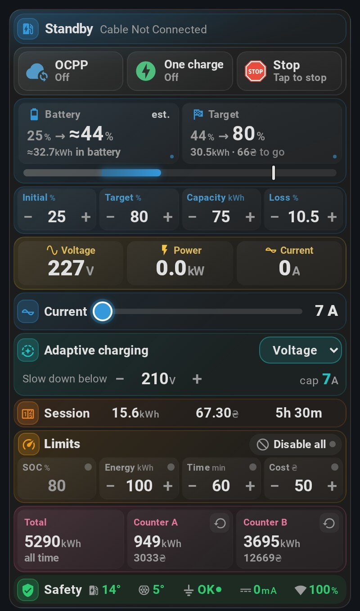
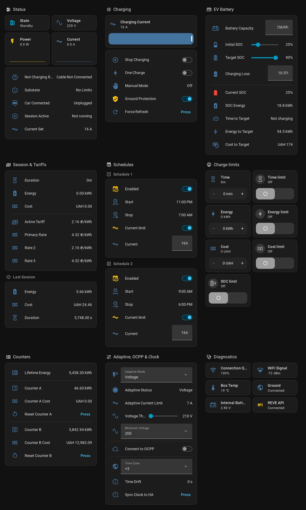

# Eveus EV Charger for Home Assistant

[](https://github.com/hacs/default)


[](https://github.com/ABovsh/eveus/releases)

**English** | [🇺🇦 Українська](README.uk.md)

Home Assistant integration for **Eveus EV chargers** (Energy Star), such as
**Eveus Pro**,
including chargers on the new **REVE firmware**. Control the charging current, schedules and limits,
stop at a target battery level (SOC), and track energy and charging cost. The
integration talks to the charger over your local network; no cloud account or
internet access is needed. Install it from the **HACS default store**.

<p align="center">
  
  
</p>

**Contents:** [Install](#installation) · [Setup](#setup) · [First charge](#first-charge) ·
[Card](#eveus-card) · [SOC](#battery-level-soc) · [Limits and schedules](#limits-schedules-and-cost) ·
[Automations](#blueprints) · [REVE](#reve-firmware) · [Help](#troubleshooting) ·
[Entities](#entity-ids) · [Changelog](CHANGELOG.md)

## Features

### 🎛️ Local charging control

- Adjust current, allow or stop charging from dashboards and automations.
- Enable one-charge mode and set time, energy and cost limits.
- The integration checks that the charger accepts each command; Home Assistant shows an error when it does not.

### 🔋 SOC and charging to a target

- **Battery and finish-time estimates** account for battery capacity and charging losses; energy and cost to the target are shown too.
- **Initial SOC from your car's sensor** is filled in when charging starts. The estimate continues through pauses and Home Assistant restarts.
- **Stop at your target SOC** by turning on its limit. Home Assistant sends the stop, so it must be running and able to reach the charger.

All SOC features require **Advanced mode**. [Set up SOC →](#battery-level-soc)

### 💰 Energy and charging cost

- **Costs from the charger** follow its tariffs, including a change from night to day rate during a session.
- **Consumption tracking:** current session, lifetime total and two resettable counters, A and B; history in the Energy dashboard.
- **Last-session summary:** energy, cost and duration stay available after Home Assistant restarts and while the charger is off.

### 📱 A ready-made card

- **Readings and controls in one card,** built from sections you tick and reorder in the card editor.
- The card shows faults and asks before it stops a charge, raises the current or resets a counter.
- A [ready-made dashboard](#dashboard) offers separate cards and graphs instead. [Add the Eveus card →](#eveus-card)

### 🧩 Automations

- **Device triggers** for car connection, charging start and finish, and charger errors.
- **Session data for your own automations:** energy, cost and duration of a finished session, and an event when the target SOC is reached.
- **Two ready-made blueprints:** session notifications, and stopping charging when your home inverter battery is low. [Import a blueprint →](#blueprints)

### ⚡ Charger readings

- **Voltage, current and power**, box and plug temperatures, ground status and leakage current; three-phase setups add each phase's current and voltage.
- **Not Charging Reason** says what is holding charging up: the car, a schedule, a limit or OCPP.

### 🕒 Schedules and adaptive charging

- **Two charging schedules** with their own current limit and, on Eveus firmware, energy limit. They are stored on the charger and run without Home Assistant.
- **Lower current when mains voltage drops:** the charger does this; the integration sets the mode and threshold and shows the current cap.

### 🔄 REVE firmware

- **Recognized automatically:** no setup change after the charger updates to REVE.
- **Reads and writes through REVE's local interface,** the one the charger's app uses: current, schedules with their days of the week, tariffs and limits.
- **Manual Mode** sensor and card notes show when REVE ignores its schedules and limits. [More about REVE →](#reve-firmware)

### 🛡️ Faults and conflicting controls

- **Repairs notices** explain ground faults, overheating, leakage and other problems, with what to do next.
- **OCPP control and connection status** in Home Assistant. While OCPP is on, a notice warns that the server or app may change settings.

Also supported: **several chargers**, **English and Ukrainian**, and older firmware with fewer readings.

## Requirements

| Requirement | Details |
| --- | --- |
| Home Assistant | 2025.1 or newer |
| Charger | Eveus 16A, 32A, 40A or 48A, reachable from Home Assistant |
| Charger firmware | [Eveus firmware](#charger-firmware) R3.05.x or [REVE firmware](#reve-firmware), both verified; Eveus firmware [R3.01.x and 1.x](#older-charger-firmware) has fewer readings |
| Network | Local network access to the charger's web interface |
| Setup details | Charger IP address, hostname or URL and model; username and password if the charger has them |

## Installation

### HACS

The integration is in the **HACS default store**; no custom repository is needed.

[](https://my.home-assistant.io/redirect/hacs_repository/?owner=ABovsh&repository=eveus&category=integration)

Or in HACS:

1. Open **HACS** and search for **Eveus EV Charger**.
2. Install it.
3. Restart Home Assistant.

### Manual

1. Copy `custom_components/eveus` into your Home Assistant `custom_components/` directory.
2. Restart Home Assistant.

## Setup

[](https://my.home-assistant.io/redirect/config_flow_start/?domain=eveus)

1. Go to **Settings → Devices & Services → Add Integration** and search for **Eveus EV Charger**.
2. Enter the charger address: IP, hostname or full URL (a custom port, `http://` and `https://` all work).
3. Enter the username and password of the charger's own web interface, **not** your Home Assistant login. Leave both empty if the charger has no password; REVE has none.
4. Pick the charger model: **16A**, **32A**, **40A** or **48A**. A model that does not match the hardware stops the charger from reporting.
5. Pick the integration mode:
   - **Basic:** charging control and monitoring.
   - **Advanced:** adds the SOC settings and SOC/finish-time sensors.
6. **Advanced only:** a second screen asks for your car's **battery capacity (kWh)** and **charging efficiency loss (%)**. Both can be changed later from their entities.

To change settings later, open the integration:

- **Configure:** mode and the optional car SOC sensor.
- **Reconfigure:** address, credentials, model and phase count.

## First charge

1. Open the **Eveus EV Charger** device under **Settings → Devices & Services**. Check that **State** and **Voltage** show current values.
2. Set **Charging Current** to suit your electrical installation.
3. In Advanced mode, set **Initial SOC** to the car's battery level, or let the integration [fill it from the car](#filling-initial-soc-from-your-car-optional).
4. Plug the connector into the car. **Stop Charging** must be off. If the charger waits, **Not Charging Reason** says why: a schedule, a limit, the car or OCPP.
5. Check **State**, **Power** and **Session Energy**. To stop charging, turn on **Stop Charging**. On REVE, a stop puts the charger in [manual mode](#manual-mode).

For everyday use, add the [Eveus card](#eveus-card), or the
[ready-made dashboard](#dashboard) for separate cards and graphs.

## Eveus card

The card comes with the integration. Each copy shows the sections you choose,
in your order, in your Home Assistant language (English or Ukrainian).

### How to add the card

1. Restart Home Assistant after installing or updating the integration, then refresh the browser. In the mobile app: **Settings → Companion app → Troubleshooting → Reset frontend cache**, then restart the app.
2. Open your dashboard → **Edit dashboard → Add card → Eveus EV Charger**.
3. Tick the sections you want, reorder them with the arrows and **Save**. A section's settings icon hides single items, e.g. Schedule 2, and sets the section's size. Set **Charger** if you have several.

If **Custom element doesn't exist** appears after an update, refresh the
browser or reset the app's frontend cache.

### Sections

| Section | Shows |
| --- | --- |
| **Status** | Charger state and why it is not charging; while charging, since when, and for a finished charge, at what time |
| **Buttons** | **OCPP**, **One charge** and **Stop** |
| **Battery SOC** | Estimated SOC and where the session started; while charging, time left and finish time; energy and cost to target, and before the charge the price per kWh; **Advanced mode only** |
| **SOC settings** | **Initial**, **Target**, **Capacity** and **Loss**; **Advanced mode only** |
| **Meter** | Voltage, power and current; with nothing flowing, a slim voltage row |
| **Current slider** | Charging current |
| **Adaptive charging** | Adaptive Mode, its voltage threshold and current cap |
| **Session** | Session energy, cost and time; with the car unplugged, the last session |
| **Limits** | Energy, time, cost and SOC limits, **Disable all** (not on REVE) |
| **Schedules** | Schedule 1 and Schedule 2, one row each: on/off, start → stop, current limit and, on Eveus firmware, energy limit. On REVE also their days of the week, which you can change, and the other schedules and the tariffs set in the charger's app, read-only |
| **Charger clock** | Time Zone, the charger's time (Time Drift instead when the clock is 10 minutes or more off) and **Sync Time** |
| **Counters** | Total Energy, Counter A and Counter B with resets; this month's and last month's energy |
| **Safety** | Box and plug temperature, ground, leakage current, connection quality |

In Basic mode the two SOC sections are hidden and Limits has no SOC limit.
A reading the charger's firmware does not report is not shown.

- **Red values:** voltage below 205 V or above 253 V; temperature from 80 °C and leakage from 30 mA, where the charger's own protection trips; Time Drift from 10 minutes.
- **Offline:** the card shows how old the last reading is and disables the controls.
- **Folding:** a card with six or more sections shows SOC settings, Adaptive charging, Limits, Schedules and Counters as one-line rows; tap a row to open it. A section's size **Small** always folds it, **Normal** keeps it open, **Large** shows bigger readings in a section with two items or fewer.
- **Hints:** a fault shows the reading behind it and what to do. **Status** says why the charge runs below the set current. While **One charge** is on, Schedules and Limits say it ignores them, with a **Turn off** button. On REVE, One charge starts [manual mode](#manual-mode), so they show the manual-mode note instead, without a button: turning One charge off does not end that mode.
- **Taps:** tap a reading to open its entity. Long-press the battery tile to set Initial SOC, the target tile for Target SOC. Stopping a charge, raising the current, resetting a counter, turning off ground protection or a limit ask you to confirm. A refused change shows a message for 30 seconds.

### Card in YAML

```yaml
type: custom:eveus-card
sections:            # any of these, in any order; omit for all of them
  - status
  - actions          # OCPP · One charge · Stop
  - advanced_info    # Battery SOC (Advanced only)
  - advanced_controls  # SOC settings (Advanced only)
  - basic_info       # voltage · power · current
  - current
  - adaptive
  - session
  - limits
  - schedules        # schedule 1 · 2
  - time             # time zone · clock or drift · sync
  - history          # this month · counters
  - safety
# hide:              # single items: section.item
#   - schedules.schedule_2
#   - safety.connection
# device_id: ...     # only with several chargers
# mode: basic        # advanced | basic (default: follows the integration)
# language: uk       # auto (default, Home Assistant's language) | uk | en
# fold: false        # default: on from six sections
# size:              # per section: small (one line) | normal | large (two items or fewer)
#   session: large
#   schedules: small
```

Cards saved with the earlier `layout:` option keep working.

## Dashboard

For separate cards and graphs, use a ready **Sections** dashboard made of
standard Home Assistant cards. It needs Home Assistant 2025.10 or newer.

| Firmware | English | Ukrainian |
|---|---|---|
| Any | [`docs/dashboard.yaml`](docs/dashboard.yaml) | [`docs/dashboard-uk.yaml`](docs/dashboard-uk.yaml) |
| REVE | [`docs/dashboard-reve.yaml`](docs/dashboard-reve.yaml) | [`docs/dashboard-reve-uk.yaml`](docs/dashboard-reve-uk.yaml) |

The general file hides the cards and rows of entities your firmware lacks. The
REVE file leaves out what REVE does not report, shows **Manual Mode** and
**REVE API**, and says when REVE accepts limit changes.



> [!IMPORTANT]
> The file is **one dashboard view**. Add it as a view, not through
> **Add card → Manual** or the raw configuration editor.

1. Open the dashboard, or create one under **Settings → Dashboards → Add dashboard**.
2. Choose **Edit dashboard → Add view** (the **+** after the view tabs), then **⋮ → Edit in YAML**.
3. Replace everything in the editor with the file.
4. Replace `eveus_ev_charger` if your entity IDs use another prefix, then **Save**.

For three phases, set **Phases = 3** and add
`sensor.eveus_ev_charger_current_phase_2`/`_3` and `…_voltage_phase_2`/`_3`
to the view.

## Battery level (SOC)

SOC is the car battery's charge level in percent. In **Advanced** mode the
integration estimates it from the initial SOC, session energy, battery capacity
and charging losses, so it is as accurate as these inputs.

| Setting | What to enter |
| --- | --- |
| **Initial SOC** | Battery level when the connector was plugged in; set by hand or filled from a car sensor |
| **Target SOC** | Battery level to charge to, for the forecasts and the SOC limit |
| **Battery Capacity** | Your car's battery capacity in kWh |
| **SOC Correction** | Percentage of delivered energy lost while charging |

**Time to Target SOC** and **Charging Finish Time** are estimates that change
with charging power. **Energy to Target SOC** includes charging losses, and
**Cost to Target SOC** follows the charger's tariff windows. Before the
charge starts, with a schedule on, it prices the energy in the schedule windows,
where the charger will draw it: at 19:00 a charge that Schedule 1 runs from
23:00 is priced at the night rate.

Setting a target alone does not stop charging: turn on **Limit: SOC enabled**.
Home Assistant sends that stop, so it must be running and able to reach the
charger. The charger itself enforces the time, energy and cost limits.

### Filling Initial SOC from your car (optional)

In Advanced mode, **Initial SOC** can be filled from your car's battery sensor
provided by another integration.

1. Pick the sensor during SOC setup, or later under **Settings → Devices & Services → Eveus EV Charger → Configure**.
2. It must be a `sensor` with device class `battery`, unit `%` and a value from 0 to 100; others are not listed.
3. Without a sensor, set **Initial SOC** by hand before charging.

- The sensor is read once per plug-in, when charging starts. If it is unavailable then, the integration retries and counts the energy already delivered.
- A value you enter by hand wins until the next plug-in.
- After you pull the connector out and plug it in again, a new initial value is needed.
- The source and any failed reading are in the `soc_anchor` attribute of **SOC Percent**.

<details>
<summary>Migrating from legacy SOC helpers</summary>

Replace the prefix `input_number.ev_` with `number.eveus_ev_charger_` in cards
and automations. For example, `input_number.ev_initial_soc` becomes
`number.eveus_ev_charger_initial_soc`.

</details>

## Limits, schedules and cost

### Charging limits

Set **Limit: Time**, **Limit: Energy** or **Limit: Cost**, then turn on its
enable switch. **Limit: disable all** suspends all limits, including SOC, and
keeps their values. On REVE, limits can be changed only while charging or
stopped at a limit, and there is no **Limit: disable all**; see
[REVE limits](#limits-on-reve).

### Schedules and adaptive charging

The charger has two schedules. Set the start and stop times, turn the schedule
on, and optionally turn on its own current and energy limits. If a schedule
runs at the wrong time, check **Time Zone** and press **Sync Time**. While
**One Charge** is on, the charger charges at once and ignores every schedule
and limit.

**Adaptive Mode** offers Off / Voltage / Auto / Power. In Voltage mode the
charger lowers the current when the voltage drops below the
**Undervoltage threshold** (210–220 V). **Adaptive Current Limit** shows the
cap the charger chose. **Minimum voltage** (150–200 V) is a separate lower
voltage limit for charging.

### Energy and cost tracking

The charger calculates session and counter costs with its own tariffs; change
the tariffs on the charger. The integration shows the current and last session,
the lifetime total and counters A and B, which reset separately. For
consumption history, add the charger to the [Energy dashboard](#energy-dashboard).

While charging, energy and cost sensors update once a minute to keep the
database small; a new session, a counter reset or the charger going offline
shows at once. The SOC limit checks every poll.

### OCPP control

**Connect to OCPP** lets the charger connect to its OCPP server, used by apps
such as Grizzl-E Connect; **OCPP Connected** shows the connection. The server
or app may change the current, limits and schedules, so a **Repairs** notice
appears while OCPP is on. Turn off **Connect to OCPP** to control the charger
only locally.

## Energy Dashboard

1. Go to **Settings → Energy** (before Home Assistant 2026: **Settings → Dashboards → Energy**).
2. Under **Individual devices**, click **Add device**.
3. Pick `sensor.eveus_ev_charger_total_energy` and save.

## Blueprints

Two ready-made automations ship with the integration. Import one from
**Settings → Automations & Scenes → Blueprints → Import Blueprint**, paste the
URL, then fill in the two or three fields it asks for.

| Blueprint | What it does | URL |
| --- | --- | --- |
| Charging session notification | Notifies on start and finish through the action of your choice; the finish message includes session energy, cost and duration. Use `{{ message }}` as the notification text | [`notify_session.yaml`](https://github.com/ABovsh/eveus/blob/main/blueprints/automation/eveus/notify_session.yaml) |
| Stop charging on low house battery | When your inverter's battery stays below a threshold for two minutes, turns on **Stop Charging**. Choose the threshold on the battery %, on its voltage, or on whichever comes first; voltage is reliable only near empty. It does not resume charging afterwards | [`stop_on_low_house_battery.yaml`](https://github.com/ABovsh/eveus/blob/main/blueprints/automation/eveus/stop_on_low_house_battery.yaml) |

## Events & Device Triggers

The integration fires these events; every payload includes `device_number`.
The first five are also **device triggers**: pick the Eveus device in the
automation editor to use them without YAML.

| Event | Fires when | Extra payload fields |
| --- | --- | --- |
| `eveus_charging_started` | A charging session begins | — |
| `eveus_charging_finished` | A charging session ends | `reason` (`complete`, `schedule`, `limit`, `unplugged`, `stopped` or `paused`), `session_energy_kwh`, `session_cost`, `session_duration_s` |
| `eveus_error` | The charger enters the error state | `error_code`, `error_text` |
| `eveus_car_connected` | The car is connected | — |
| `eveus_car_disconnected` | The car is disconnected | — |
| `eveus_soc_limit_reached` | Home Assistant stopped charging at Target SOC | `soc`, `target_soc` |

Session values come from the charger's polls; when the car is unplugged
during a charge, they may miss the last poll interval. Changes while Home
Assistant or the charger is offline fire no events afterwards, and neither
does a replug quicker than one poll (up to a minute while the charger is idle).

```yaml
automation:
  - alias: Eveus session summary
    triggers:
      - trigger: event
        event_type: eveus_charging_finished
    actions:
      - action: notify.notify
        data:
          message: >-
            Session finished ({{ trigger.event.data.reason }}):
            {{ trigger.event.data.session_energy_kwh }} kWh,
            {{ trigger.event.data.session_cost }} UAH
```

## 🛡️ Safety notices

Open **Settings → System → Repairs** for the cause and what to do. These
notices report problems; they do not replace the charger's own protection.
Temperature, leakage and ground readings must repeat before a notice appears;
known charger fault codes raise one at once.

### Safety conditions

| Notice | Action |
| --- | --- |
| Ground is missing | Stop charging and have an electrician check the grounding |
| Ground protection is disabled | Turn on **Ground Protection**; without it the charger charges without confirmed ground |
| Box or plug overheating | Stop using the charger and let it cool; contact the manufacturer if it repeats. Raised at a sustained **80 °C or higher** or a charger overheat fault |
| Current leakage (GFCI) | Stop using the charger and contact the manufacturer. Raised by a fault or a sustained leakage of **30 mA or more** |
| Charger protection fault | Stop or avoid charging and contact the manufacturer |
| Charger error with unknown cause | Check the charger's display or app; include the error in a support request if it persists |
| Charger backup battery is low | Replace the internal CR2032 cell |

Ground notices clear after recovery. Serious fault notices also need
**Ignore**; a new incident after recovery notifies you again.

### Configuration notices

| Notice | Action |
| --- | --- |
| Charger setup needs attention | Open the notice and re-enter the connection details |
| OCPP is enabled | For local control only, turn off **Connect to OCPP** |
| Charger clock is off by more than 10 minutes | Check **Time Zone**, then press **Sync Time** |
| REVE firmware stopped reporting some readings | Update the integration when a new version is out; if the notice stays, open a GitHub issue with the diagnostics |
| Update SOC cards and automations | Replace `input_number.ev_*` with the integration's SOC entities; see [migration](#battery-level-soc) |

## Charger firmware

Eveus chargers run one of two firmwares: **Eveus firmware** (R3.x and 1.x) or
**REVE firmware**. The device page shows which one: a firmware version that
starts with `REVE_PLUS` is REVE; anything else is Eveus firmware. In the
CHANGELOG, `Eveus:` and `REVE:` mark a change for one firmware only; a change
without either applies to both.

### REVE firmware

REVE is a newer firmware for Eveus chargers; the device page shows it as `REVE_PLUS`. The
integration recognizes it by itself; no setup change is needed. Everything
above works the same, except as described here.

#### Manual mode

REVE has a **manual mode** in which it ignores its schedules and its time,
energy and cost limits. The charger enters it after:

- any stop: **Stop Charging** in Home Assistant or the app, the Target SOC stop, or the low-battery blueprint;
- **One Charge**, or a start with "ignore schedule" in the charger's app.

A limit that stops charging by itself does not start manual mode. Manual mode
ends when you pull the connector out of the car. After you plug it back in,
the schedules and limits apply again.

What this means in practice:

- Turning **Stop Charging** or **One Charge** off does not end manual mode: the charger keeps ignoring its schedules and limits until the connector is pulled out.
- The charger does not report the mode, so the **Manual Mode** sensor follows the commands the integration sees or sends, and turns off when the connector is pulled out. It keeps its state through a Home Assistant restart, unless the connector was pulled out meanwhile.
- While **Manual Mode** is on, the card says that schedules and limits are ignored.

#### Limits on REVE

- **Time**, **Energy** and **Cost** limits can be set, changed, turned on or off only **outside manual mode, while the car is charging or a limit has stopped the charge**. REVE drops a limit set before charging starts, and every limit when the connector is pulled out, so at other times the card locks the limits and says why, and Home Assistant refuses the change with the reason.
- When a limit stops the charge, raise it or turn it off to charge on: the charger resumes by itself, and a raised limit stops it at the new value. **One Charge** charges on too, but puts the charger in manual mode, so no limit applies until the connector is pulled out.
- Turning a limit on sends the value of its number; turning it off removes the limit, and the number keeps its value.
- **Target SOC** can be changed at any time: Home Assistant does that stop.
- REVE has no **Limit: disable all**: the charger drops that setting within seconds, so the switch is not created and the card does not show it.

#### Other differences

- **Adaptive Mode** has Off, Voltage and Auto; REVE has no Power option.
- **Schedule 1** and **Schedule 2** are the first two schedules in the charger's app. Their days of the week are changed on the card; the days set in the app are kept. The card also lists the other schedules and the tariffs that are set up in the app. Schedules and tariffs changed in the app appear in Home Assistant within about five minutes.
- **Primary Rate Cost** is REVE's base price; **Rate 2** and **Rate 3** are its first two rates. **Active Rate Cost** is the price in effect by the charger's clock, and its `rate_name` attribute is the rate's name in the app. While REVE's third or fourth rate is in effect, it gives that rate's price; those rates have no entities of their own. **Cost to Target SOC** follows the first two rates' hours and the schedules' hours, not their days of the week.
- **Counter A Cost** and **Counter B Cost** do not increase on REVE: the charger counts the energy of counters A and B, but not their cost. After a counter is reset its cost stays at 0; without a reset it keeps its previous value. The cost of a charge is in **Session Cost** and **Last Session Cost**.
- **REVE API** (diagnostic) shows whether REVE's interface answers; it turns off after two failed reads in a row. The interface sometimes stops answering for a few minutes. Meanwhile readings come from the charger's older `/main` page, schedules and tariffs keep their last values, and changing a setting fails with "REVE interface is not answering".
- REVE schedules have no energy limit, so **Schedule 1 Energy limit**, **Schedule 2 Energy limit** and their switches are not created.
- REVE does not report **Leakage Current**, **Leakage Current Peak**, **OCPP Connected** or **Plug Temperature**, so they stay unavailable.

#### Wi-Fi drops about every 15 minutes

REVE does not lower its packet size on a link with an MTU below 1500. When the
charger reaches the internet through a VPN or tunnel with a smaller MTU, its
connection to the maker's cloud hangs and the charger restarts its Wi-Fi.
Set the maximum segment size (MSS) of that tunnel on the router, e.g. 1284 for
an MTU of 1324 (Keenetic: `ip tcp adjust-mss 1284` on the tunnel interface), or
let the charger reach the internet outside the tunnel.

### Older charger firmware

R3.01.x and firmware 1.x (EnergyStar V-series) are supported with fewer
readings; the ones the charger does not report stay unavailable. An unknown
state shows `Unknown`, with its code in the **State** sensor's `raw_state`
attribute.

For firmware updates, message **@energy_star** on Telegram; install the file
through the charger's web interface.

## Troubleshooting

More help: [integration website](https://abovsh.github.io/eveus/) · [community discussion](https://community.home-assistant.io/t/eveus-ev-charger-home-assistant-integration-local-only-hacs/1010628) · [report an issue](https://github.com/ABovsh/eveus/issues).

| Problem | What to check |
| --- | --- |
| Setup cannot connect | Read the error in the setup dialog. "Refused the connection": the address belongs to another device. "Cannot reach the network": Home Assistant has no route to the charger's network. Otherwise check power, credentials and model |
| The charger is not in Devices | See [below](#the-charger-does-not-appear-after-installing) |
| Controls do not respond | Check **Connection Quality**, that the charger is reachable, and the credentials under **Reconfigure** |
| SOC sensors are missing | Switch the mode to Advanced under **Configure** |
| SOC is wrong after replugging | Set **Initial SOC** to the real battery level before the next charge |
| On REVE, the charger ignores a schedule or limit | It is in [manual mode](#manual-mode): pull the connector out and plug it back in |
| REVE reconnects to Wi-Fi about every 15 minutes | See [Wi-Fi drops](#wi-fi-drops-about-every-15-minutes) |
| The charger is off | Normal: the integration polls less often and does not fill the log with errors; readings return within a minute after power comes back |
| A Repairs notice appeared | See [Safety notices](#-safety-notices) |

If the charger rejects the credentials after a password change, the
integration asks you to enter them again.

### The charger does not appear after installing

1. **Add the integration after installing it through HACS.** Restart Home Assistant, then open **Settings → Devices & Services → Add Integration → Eveus EV Charger**. A single update entity means you are looking at the HACS entry, not the charger.
2. **Check disabled integrations.** At the bottom of the **Integrations** tab, click **Show disabled integrations** and enable Eveus if listed.
3. **Open the Eveus card on the Integrations tab.** If it shows **Failed setup, will retry**, open the error details; they are also in **Settings → System → Logs**.

When reporting a problem, include the firmware version, the setup error and the
Eveus warning from **Settings → System → Logs**. Remove IP addresses and serial
numbers first.

## Entity IDs

Default IDs below assume a charger named **Eveus EV Charger**. If you renamed
entities or added several chargers, check the device page. The number of
entities depends on the mode, the phase count and the firmware.

WiFi Signal, Connection Quality, Current Set, Adaptive Current Limit, Active
Rate Cost, Energy to Target SOC and SOC Energy keep ordinary history only, with
no long-term statistics.

### Charging State And Controls

<details>
<summary>Show entities</summary>

| Entity ID | What it gives you |
| --- | --- |
| `sensor.eveus_ev_charger_state` | Main charger state; selectable values in automation triggers. The `since` attribute is when the charger entered this state; it is absent when that moment is not known |
| `sensor.eveus_ev_charger_substate` | Detailed state or fault; selectable values in automation triggers |
| `sensor.eveus_ev_charger_not_charging_reason` | Why charging is waiting; **Controlled by OCPP** while OCPP is on. Fault details: `error` attribute (modern firmware) |
| `binary_sensor.eveus_ev_charger_car_connected` | Vehicle is electrically connected |
| `binary_sensor.eveus_ev_charger_session_active` | Charging session is active or paused |
| `binary_sensor.eveus_ev_charger_ocpp_connected` | Reported OCPP connection state (diagnostic) |
| `binary_sensor.eveus_ev_charger_reve_api` | Whether the charger's REVE interface answers (diagnostic; REVE firmware only) |
| `binary_sensor.eveus_ev_charger_manual_mode` | On while the charger is in [manual mode](#manual-mode) and ignores its schedules and limits (REVE firmware only) |
| `number.eveus_ev_charger_charging_current` | Current limit (A); bounds depend on the charger model |
| `number.eveus_ev_charger_limit_time` | **Limit: Time** session limit (min) |
| `number.eveus_ev_charger_limit_energy` | **Limit: Energy** session limit (kWh) |
| `number.eveus_ev_charger_limit_cost` | **Limit: Cost** session limit (UAH) |
| `select.eveus_ev_charger_minimum_voltage` | **Minimum voltage** — lowest charging voltage (150–200 V); separate from the adaptive threshold |
| `switch.eveus_ev_charger_stop_charging` | Stop/allow charging from the charger side |
| `switch.eveus_ev_charger_one_charge` | Enable one-charge mode |
| `switch.eveus_ev_charger_ground_protection` | Missing-ground shutdown protection |
| `switch.eveus_ev_charger_connect_to_ocpp` | OCPP connection; the server/app may override local controls |
| `switch.eveus_ev_charger_limit_time_enabled` | **Limit: Time enabled** |
| `switch.eveus_ev_charger_limit_energy_enabled` | **Limit: Energy enabled** |
| `switch.eveus_ev_charger_limit_cost_enabled` | **Limit: Cost enabled** |
| `switch.eveus_ev_charger_limit_disable_all` | **Limit: disable all**; not created on REVE |
| `switch.eveus_ev_charger_limit_soc_enabled` | **Limit: SOC enabled** (Advanced mode only) |
| `button.eveus_ev_charger_force_refresh` | Poll the charger immediately |

</details>

### Charger readings

<details>
<summary>Show entities</summary>

| Entity ID | Unit | What it gives you |
| --- | --- | --- |
| `sensor.eveus_ev_charger_voltage` | V | Line voltage |
| `sensor.eveus_ev_charger_current` | A | Charging current |
| `sensor.eveus_ev_charger_power` | W | Charging power |
| `sensor.eveus_ev_charger_current_set` | A | Charger current setpoint |
| `sensor.eveus_ev_charger_current_phase_2` | A | Phase 2 current when `Phases = 3` |
| `sensor.eveus_ev_charger_current_phase_3` | A | Phase 3 current when `Phases = 3` |
| `sensor.eveus_ev_charger_voltage_phase_2` | V | Phase 2 voltage when `Phases = 3` |
| `sensor.eveus_ev_charger_voltage_phase_3` | V | Phase 3 voltage when `Phases = 3` |

</details>

### Energy, Cost, And Tariffs

<details>
<summary>Show entities</summary>

| Entity ID | Unit | What it gives you |
| --- | --- | --- |
| `sensor.eveus_ev_charger_session_time` | Sensor | Elapsed duration of the current charging session |
| `sensor.eveus_ev_charger_session_energy` | kWh | Energy delivered in the current session |
| `sensor.eveus_ev_charger_total_energy` | kWh | Lifetime energy counter |
| `sensor.eveus_ev_charger_counter_a_energy` | kWh | Resettable energy counter A |
| `sensor.eveus_ev_charger_counter_b_energy` | kWh | Resettable energy counter B |
| `sensor.eveus_ev_charger_session_cost` | UAH | Current session cost from the charger |
| `sensor.eveus_ev_charger_counter_a_cost` | UAH | Cost accumulated on counter A |
| `sensor.eveus_ev_charger_counter_b_cost` | UAH | Cost accumulated on counter B |
| `sensor.eveus_ev_charger_primary_rate_cost` | UAH/kWh | Primary tariff |
| `sensor.eveus_ev_charger_active_rate_cost` | UAH/kWh | Currently active tariff |
| `sensor.eveus_ev_charger_rate_2_cost` | UAH/kWh | Rate 2 price |
| `sensor.eveus_ev_charger_rate_3_cost` | UAH/kWh | Rate 3 price |
| `sensor.eveus_ev_charger_rate_2_status` | Sensor | Whether Rate 2 schedule is enabled |
| `sensor.eveus_ev_charger_rate_3_status` | Sensor | Whether Rate 3 schedule is enabled |
| `sensor.eveus_ev_charger_last_session_energy` | kWh | Last finished session energy; retained across restarts and outages |
| `sensor.eveus_ev_charger_last_session_cost` | UAH | Cost of the most recently finished session |
| `sensor.eveus_ev_charger_last_session_duration` | s | Duration of the most recently finished session. Home Assistant's own cards show seconds as a number; set the entity's unit to hours (h) in its settings to see `1h 36m`. The Eveus card reads any unit |

Each Last Session sensor is populated when a session finishes and carries `reason` and `finished_at` attributes.

</details>

### SOC And ETA, Advanced Mode

Advanced mode provides four `number` entities for SOC settings.

<details>
<summary>Show entities</summary>

| Entity ID | Unit | Range | Default | What it gives you |
| --- | --- | --- | --- | --- |
| `number.eveus_ev_charger_initial_soc` | % | 0-100, step 1 | 20 | Battery SOC at the start of the current charging session |
| `number.eveus_ev_charger_target_soc` | % | 0-100, step 5 | 80 | Target battery level for forecasts and the SOC limit |
| `number.eveus_ev_charger_battery_capacity` | kWh | 10-160, step 1 | 50 | EV battery capacity |
| `number.eveus_ev_charger_soc_correction` | % | 0-20, step 0.5 | 7.5 | Charging loss correction |
| `sensor.eveus_ev_charger_soc_energy` | kWh | - | - | Estimated energy currently in the EV battery |
| `sensor.eveus_ev_charger_soc_percent` | % | - | - | Estimated battery percentage |
| `sensor.eveus_ev_charger_time_to_target_soc` | Sensor | - | - | Human-readable ETA to target SOC |
| `sensor.eveus_ev_charger_charging_finish_time` | Timestamp | - | - | Absolute finish time for automations and timestamp cards |
| `sensor.eveus_ev_charger_energy_to_target_soc` | kWh | - | - | Grid energy still needed to reach Target SOC (charging losses included) |
| `sensor.eveus_ev_charger_cost_to_target_soc` | UAH | - | - | Forecast cost of reaching Target SOC, following the charger's tariff windows |

</details>

### Adaptive Charging And Schedules

<details>
<summary>Show entities</summary>

| Entity ID | Type | What it gives you |
| --- | --- | --- |
| `select.eveus_ev_charger_adaptive_mode` | Select | Adaptive mode: Off / Voltage / Auto / Power |
| `sensor.eveus_ev_charger_adaptive_charging` | Sensor | Active adaptive mode (Off / Voltage / Auto / Power) |
| `sensor.eveus_ev_charger_adaptive_current_limit` | A | Current cap selected by adaptive mode |
| `number.eveus_ev_charger_undervoltage_threshold` | V | **Undervoltage threshold** — Voltage-mode trigger (210–220 V) |
| `switch.eveus_ev_charger_schedule_1_enabled` | Switch | Enable or disable schedule slot 1 |
| `time.eveus_ev_charger_schedule_1_start` | Time | Schedule 1 start time |
| `time.eveus_ev_charger_schedule_1_stop` | Time | Schedule 1 stop time |
| `number.eveus_ev_charger_schedule_1_current_limit` | A | **Schedule 1 Current limit** |
| `switch.eveus_ev_charger_schedule_1_current_limit_enabled` | Switch | **Schedule 1 Current limit enabled** |
| `number.eveus_ev_charger_schedule_1_energy_limit` | kWh | **Schedule 1 Energy limit**; not created on REVE |
| `switch.eveus_ev_charger_schedule_1_energy_limit_enabled` | Switch | **Schedule 1 Energy limit enabled**; not created on REVE |
| `sensor.eveus_ev_charger_schedule_1` | Sensor | Schedule 1 summary and attributes |
| `switch.eveus_ev_charger_schedule_2_enabled` | Switch | Enable or disable schedule slot 2 |
| `time.eveus_ev_charger_schedule_2_start` | Time | Schedule 2 start time |
| `time.eveus_ev_charger_schedule_2_stop` | Time | Schedule 2 stop time |
| `number.eveus_ev_charger_schedule_2_current_limit` | A | **Schedule 2 Current limit** |
| `switch.eveus_ev_charger_schedule_2_current_limit_enabled` | Switch | **Schedule 2 Current limit enabled** |
| `number.eveus_ev_charger_schedule_2_energy_limit` | kWh | **Schedule 2 Energy limit**; not created on REVE |
| `switch.eveus_ev_charger_schedule_2_energy_limit_enabled` | Switch | **Schedule 2 Energy limit enabled**; not created on REVE |
| `sensor.eveus_ev_charger_schedule_2` | Sensor | Schedule 2 summary and attributes |

Each schedule has its own current and energy caps with separate enable switches.

</details>

### Diagnostics And Maintenance

<details>
<summary>Show entities</summary>

| Entity ID | Unit | What it gives you |
| --- | --- | --- |
| `sensor.eveus_ev_charger_connection_quality` | % | Recent polling success, latency, and health attributes |
| `sensor.eveus_ev_charger_ground` | Sensor | Ground status |
| `sensor.eveus_ev_charger_time_drift` | s | Charger local clock vs Home Assistant local time (0 = in sync; a steady ±3600 means a wrong Time Zone or DST mismatch) |
| `sensor.eveus_ev_charger_box_temperature` | °C | Charger body temperature |
| `sensor.eveus_ev_charger_plug_temperature` | °C | Plug temperature |
| `sensor.eveus_ev_charger_battery_voltage` | V | Charger backup battery voltage |
| `sensor.eveus_ev_charger_leakage_current` | mA | Current leakage reading |
| `sensor.eveus_ev_charger_leakage_current_peak` | mA | Peak leakage reading |
| `sensor.eveus_ev_charger_wifi_signal` | dBm | Charger Wi-Fi signal |
| `select.eveus_ev_charger_time_zone` | Select | Charger time-zone offset, `-12` to `+14` |
| `button.eveus_ev_charger_sync_time` | Button | Push Home Assistant time to the charger |
| `button.eveus_ev_charger_reset_counter_a` | Button | Reset counter A |
| `button.eveus_ev_charger_reset_counter_b` | Button | Reset counter B |

</details>

## Privacy And Diagnostics

Home Assistant stores connection details, SOC settings and the last-session summary. Entity history follows your Recorder settings. Diagnostics downloads redact credentials and identifying fields before export. Charger communication stays on your LAN.

## License

MIT.
